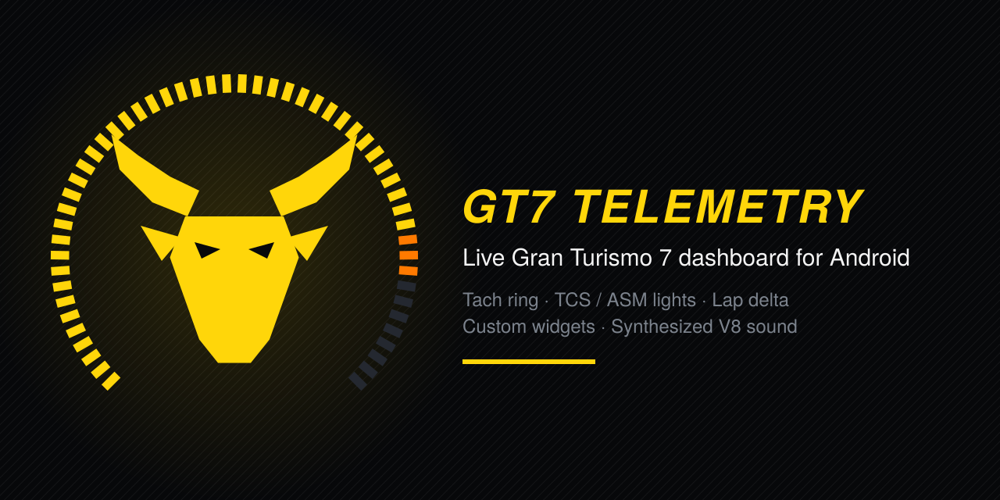
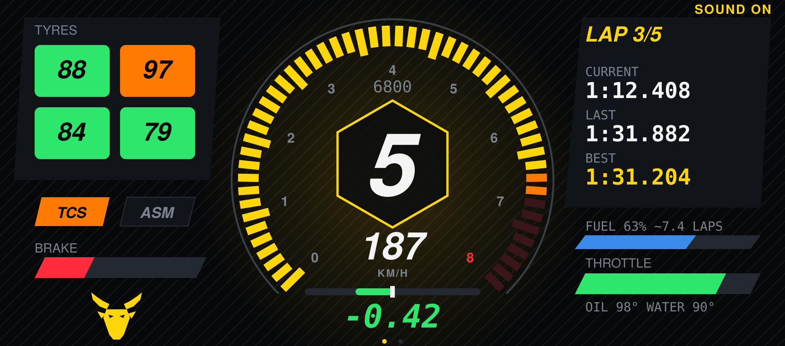
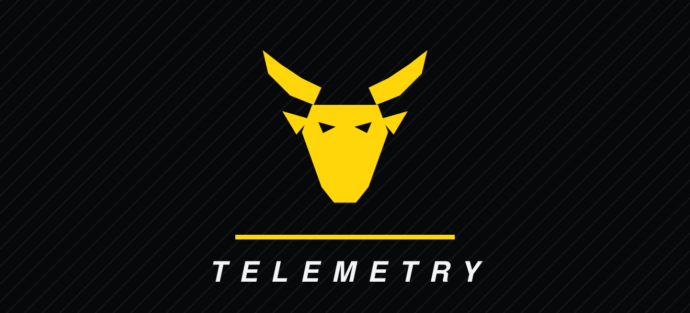
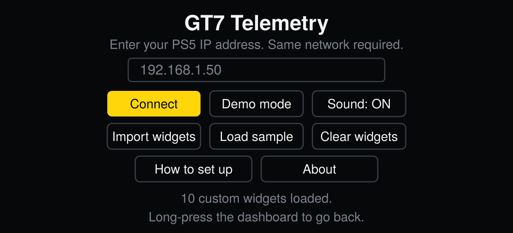
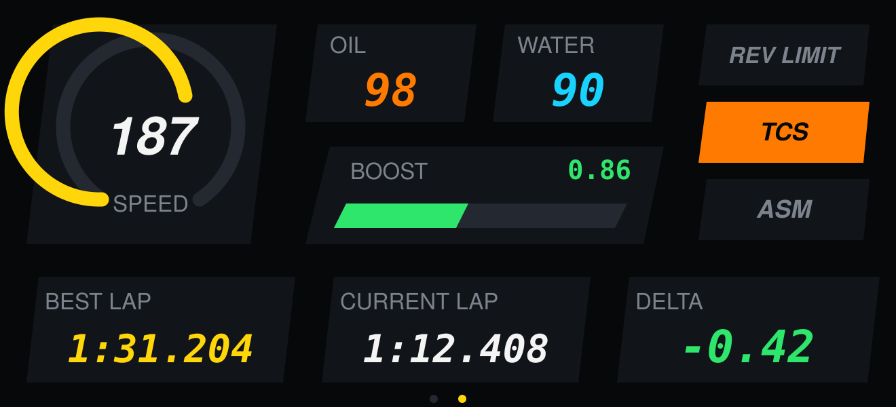
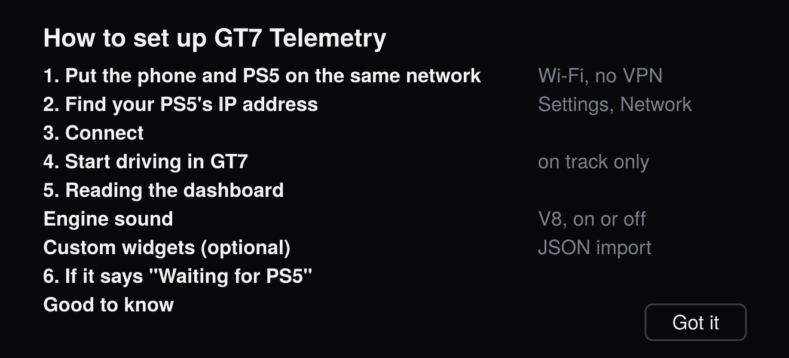
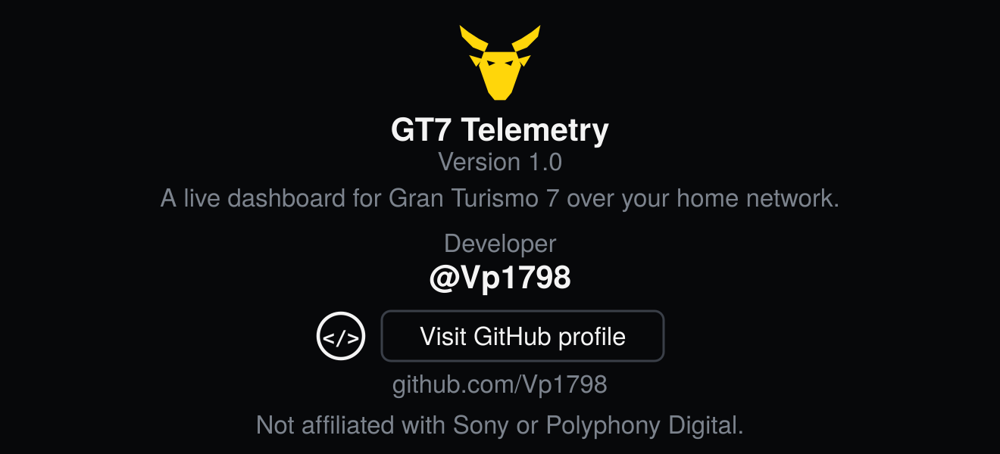

  

# GT7 Telemetry

A live Gran Turismo 7 dashboard for Android. It reads the telemetry your own PS5 sends over your home network and shows it as a supercar-style cockpit: tach ring, gear, speed, pedals, tyres, fuel, lap times and live delta to your best lap.

> The images below are design previews of the app's screens, not phone screenshots.

## Features

- **Cockpit dashboard**: segmented tach ring with shift colours and a rev-limiter flash, gear in a hexagon, speed, pedals, tyre temperatures, fuel and laps of fuel left
- **Live delta to best lap**, plus current, last and best lap times
- **TCS and ASM activity lights** that glow when the aids are actually stepping in
- **Custom widgets**: import a small JSON file to add your own numbers, bars, arc gauges and lights on a second page
- **Synthesized V8 engine sound** that follows RPM and throttle (generated by the app, no recordings), with a mute toggle
- **Demo mode** to try everything without a PS5
- **In-app setup manual** and About screen

## Screens

  

| Launch screen | Main screen |
|---|---|
|  |  |

| Custom widgets page | Setup manual |
|---|---|
|  |  |

| About |
|---|
|  |

## Install

1. Open the [Releases](../../releases) page and download the latest `.apk`.
2. Copy it to your Android phone (Android 8.0 or newer) and allow installing from unknown sources.
3. Open **GT7 Telemetry**.

## Use

1. Put the phone and the PS5 on the same Wi-Fi or router. No guest network and no VPN.
2. On the PS5, open Settings > Network > Connection Status > View Connection Status and note the IP address.
3. Enter the IP address in the app and tap **Connect**.
4. Start a race, time trial or Free Run in GT7. Data is only sent while you are on track.

Tap the dashboard to switch to your widgets page. Tap the top-right corner to turn the sound on or off. Long-press to go back.

## Custom widgets

Tap **Import widgets** and pick a `.json` file, or tap **Load sample**. See [`sample_widgets.json`](sample_widgets.json) for an example. Each widget sets a type (`number`, `bar`, `arc`, `light`, `text`), a data source (such as `rpm`, `speed_kmh`, `oil_temp`, `delta`, `tcs`), colour, range, alert values, and a position and size as percentages of the screen. The full list is in the in-app manual.

## Build from source

- **GitHub Actions**: the workflow in `.github/workflows/build-apk.yml` builds a debug APK on every push. Download it from the run's Artifacts.
- **Android Studio**: open the project folder and choose Build > Build APK(s).

## How it works

The app sends a heartbeat byte to the PS5 on UDP port 33739. The PS5 then streams 296-byte packets to port 33740 on the phone, encrypted with Salsa20. The app decrypts and parses them. The `tools/` folder has a fake PS5 (`fake_ps5.py`) for testing on a computer.

## Limits

- GT7 only shares data about your own car. There are no positions or gaps to other drivers.
- The app only reads data. It cannot change TCS, ABS, brake balance or any other setting in the game.

## Disclaimer

Not affiliated with, endorsed by, or sponsored by Sony Interactive Entertainment or Polyphony Digital. Gran Turismo is a trademark of its owners.

## Author

Made by [@Vp1798](https://github.com/Vp1798).
